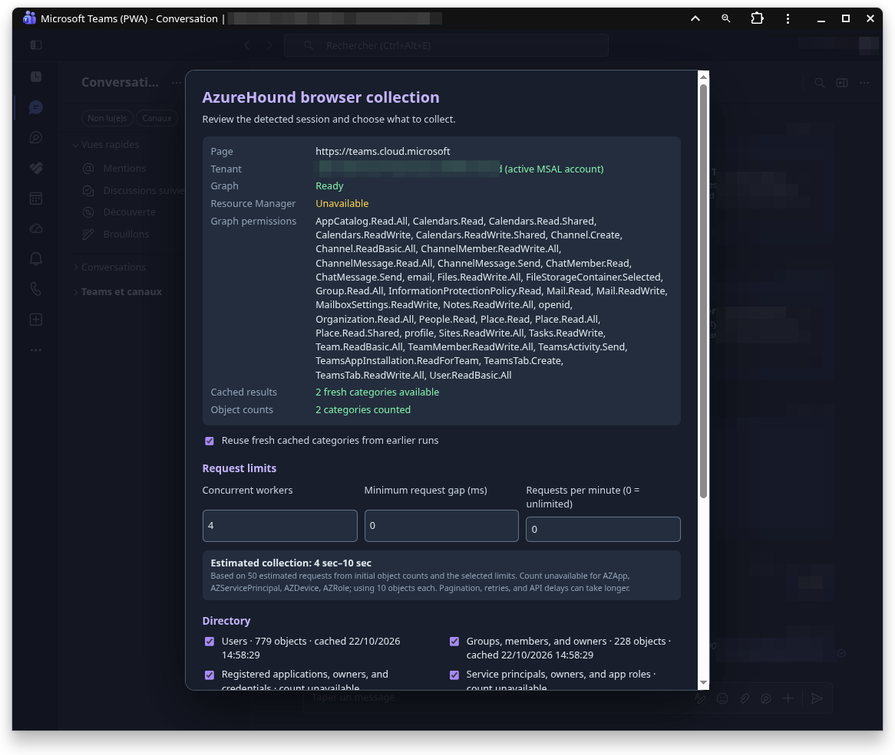
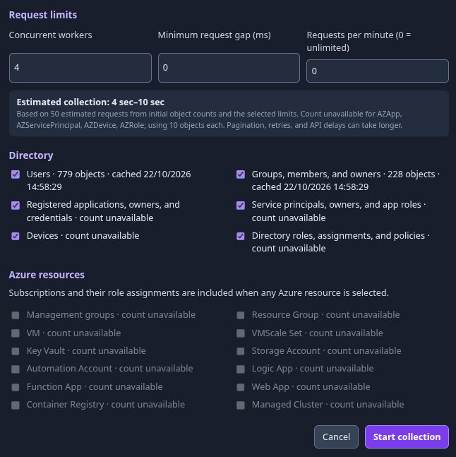
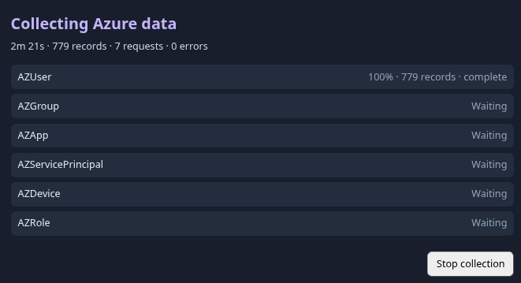
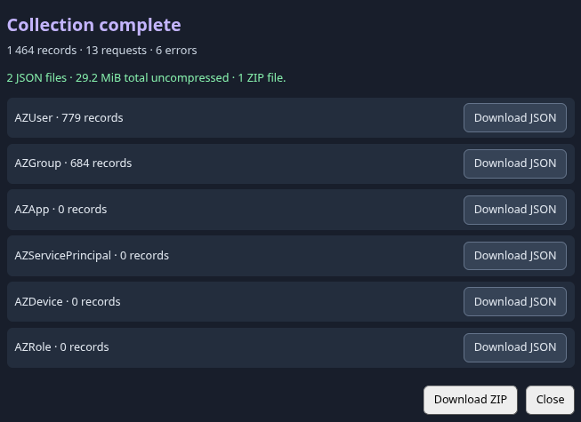

# AzureHound browser collector

Collect Microsoft Entra ID and Azure resource data from a signed-in portal tab for import into BloodHound CE. The collector runs in the browser and downloads ZIP files.

## Use it

1. Sign in to [Azure Portal](https://portal.azure.com/), a Microsoft 365 admin page, Microsoft Teams, Outlook, whatever is connected with MSAL tokens. Open that tab's Developer Tools console.
2. Paste and run the full contents of [collector.js](collector.js).



3. Review the detected tenant and access in the popup. Select categories, adjust the request limits if needed, then click **Start collection**. Keep the tab open until it finishes.



4. Download **every ZIP part** shown in the popup and import each one into BloodHound CE. You can also download a category's JSON files separately.





The popup shows object counts, a time estimate, and live progress. Select at least one of **Users**, **Groups**, **Registered applications**, or **Service principals** to make an importable collection.

## If the session is not detected

The page needs a Microsoft Graph token. Azure resource collection also needs an Azure Resource Manager token. If the popup shows a missing token or the wrong tenant, click **Cancel**, set the needed values in the console, and run `collector.js` again:

```js
window.AzureHoundConfig = {
  tenantId: '<tenant GUID>',
  graphToken: '<Microsoft Graph access token>',
  armToken: '<Azure Resource Manager access token>'
};
```

Omit values that were detected correctly. For missing data or a blocked download, inspect `window.AzureHound.report()` in the console.

## Run it again

Completed categories are cached in the page's browser storage. To collect fresh data, clear **Reuse fresh cached categories** in the popup. The cache and downloads contain collected directory and resource data; clear the site's browser data when you no longer need the cache.

## Build the browser script

The TypeScript source is in `src/`. With Node.js 18 or newer:

```sh
npm ci
npm run build
```

This regenerates `collector.js` for pasting into the portal console.
